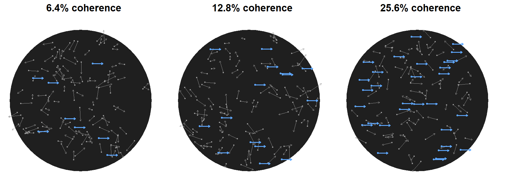
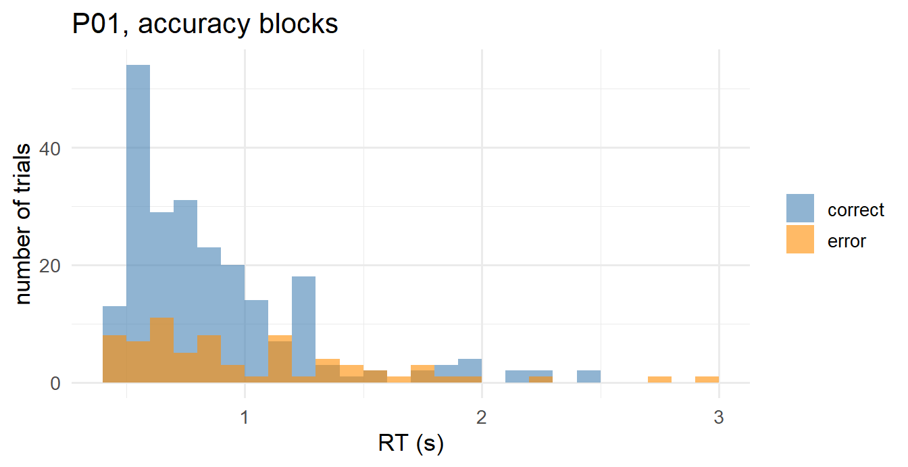

# (PART) Perceptual Decisions {-}

# The Idea {#the-idea}

## The Task

In a **random-dot motion** task, a cloud of dots appears on the screen. Some of the
dots move together, all to the left or all to the right; the rest move randomly. The
participant presses one key if the coherent dots are moving left and another if they are
moving right, as quickly and accurately as they can.

The task's difficulty is set by the **coherence**: the share of dots that move together.
At 25.6% coherence, a quarter of the dots move the same way and the direction is fairly
easy to see. At 6.4%, only one dot in sixteen does, and the display looks almost random.

Try it below. Press the coherence buttons to change how many dots move together, and
**show coherent dots** to colour the dots that are moving coherently on each frame. At
the lower coherence levels, see how long it takes you to be sure of the direction.

<iframe src="apps/rdm/embed.html" width="100%" height="305" style="border: none;"
title="Random-dot motion display"></iframe>

## What Coherence Means

The figure below shows the same idea on paper. Each panel is one moment of the display,
with an arrow for where each dot moves next. The blue dots belong to the coherent motion
and all move right by the same amount. The grey dots are noise: each moves a random
distance in a random direction. The only thing that changes between the panels is the
share of blue dots.



At 6.4% coherence, 8 of these 120 dots move together, and their rightward motion is
easy to miss among the random motion of the others. At 25.6%, 31 dots move together and
the direction stands out. Every dot carries a little evidence, and the coherent ones
carry it consistently in one direction: that is the evidence the DDM describes as
accumulating over time.

## The Data

The data for Part 1 come from 20 simulated participants. Each did 600 trials: three
coherence levels (6.4%, 12.8% and 25.6%), motion to the left or right, and two kinds of
block. In **accuracy** blocks they were told to be as accurate as possible, and in
**speed** blocks to respond as quickly as possible.


``` r
rdm <- read_csv("data/rdm.csv", show_col_types = FALSE)
head(rdm)
```

<div class="kable-table">

|participant | trial|instruction | coherence|direction |response |    rt| correct|
|:-----------|-----:|:-----------|---------:|:---------|:--------|-----:|-------:|
|P01         |     1|accuracy    |     0.064|left      |right    | 1.301|       0|
|P01         |     2|accuracy    |     0.064|right     |right    | 0.569|       1|
|P01         |     3|accuracy    |     0.256|left      |left     | 0.671|       1|
|P01         |     4|accuracy    |     0.064|left      |left     | 0.466|       1|
|P01         |     5|accuracy    |     0.128|left      |left     | 1.202|       1|
|P01         |     6|accuracy    |     0.256|right     |right    | 0.688|       1|

</div>

Each row is one trial: who did it, which block it was in, the coherence and direction
of the motion, the response, the response time (RT) in seconds, and whether the response
was correct.

## What The Data Look Like

Accuracy and median RT for each coherence level and block, across all 20 participants:


``` r
rdm |>
  group_by(instruction, coherence) |>
  summarise(accuracy = mean(correct), median_rt = median(rt), .groups = "drop")
```

<div class="kable-table">

|instruction | coherence| accuracy| median_rt|
|:-----------|---------:|--------:|---------:|
|accuracy    |     0.064|    0.645|     0.825|
|accuracy    |     0.128|    0.782|     0.807|
|accuracy    |     0.256|    0.921|     0.698|
|speed       |     0.064|    0.599|     0.516|
|speed       |     0.128|    0.695|     0.516|
|speed       |     0.256|    0.805|     0.496|

</div>

Two patterns stand out:

- higher coherence gives more accurate responses, and in accuracy blocks also faster ones;
- speed blocks give faster responses, but less accurate ones.

The second pattern is the **speed-accuracy trade-off**: people can buy speed by
accepting more errors, or accuracy by taking longer. Any model of these decisions has to
explain accuracy and RT together, not one at a time.


``` r
rdm |>
  filter(participant == "P01", instruction == "accuracy") |>
  mutate(outcome = if_else(correct == 1, "correct", "error")) |>
  ggplot(aes(x = rt, fill = outcome)) +
  geom_histogram(binwidth = 0.1, boundary = 0, position = "identity", alpha = 0.6) +
  scale_fill_manual(values = c(correct = "steelblue", error = "darkorange")) +
  labs(x = "RT (s)", y = "number of trials", fill = NULL, title = "P01, accuracy blocks")
```



The RTs of one participant show the shape that almost every two-choice task produces:
no responses faster than about a third of a second, a peak soon after, and a long tail
of slow responses to the right.

## Evidence Accumulation

The DDM's explanation is that on each trial the decision-maker collects evidence until
there is enough to commit to a response. It describes the evidence with a single number,
the **evidence total** $X$. Evidence for "right" pushes $X$ up, and evidence for "left"
pushes it down. $X$ starts somewhere between two boundaries and changes from moment to
moment. When it reaches the upper boundary the response is "right"; when it reaches the
lower boundary the response is "left".

$X$ changes for two reasons. Part of the change is systematic: if the coherent dots move
right, the display favours "right", so on average $X$ moves up. The higher the
coherence, the faster it moves. The other part is random: moment-to-moment noise in the
display, in perception and in attention pushes $X$ up or down. Because of the noise, the
same display can lead to different responses and different RTs on different trials.

## Start, Boundaries And Response Time

The lower boundary is at 0 and the upper boundary at $a$. The evidence total starts at

$$
X(0) = z\,a,
$$

a fraction $z$ of the way from the lower to the upper boundary. With $z = 0.5$ it starts
halfway. With $z = 0.6$ it starts closer to the upper boundary, so less evidence is
needed for "right" than for "left".

The response is made at the first moment $X$ reaches either boundary. The time this takes
is the **decision time**. The observed RT also includes time spent on things other than
deciding, such as seeing the dots and pressing the key:

$$
\text{RT} = T_{er} + T_{decision}.
$$

| Parameter | Symbol | Meaning | In the random-dot task |
|---|---|---|---|
| drift rate | $v$ | average evidence gained per second | larger at higher coherence; positive for rightward motion |
| boundary separation | $a$ | distance between the boundaries: how much evidence is needed (caution) | larger in accuracy blocks than in speed blocks |
| relative starting point | $z$, between 0 and 1 | where $X$ starts, as a fraction of $a$; 0.5 is unbiased | above 0.5 if someone favours "right" before seeing anything |
| non-decision time | $T_{er}$ (`t0` in code) | time for seeing the display and pressing the key | the same whatever the coherence or block |
| noise | $\sigma$ | size of the random part of the change in $X$ | fixed at 1 (Chapter \@ref(step-by-step)) |

The last column is the reason this task is so often used to teach the DDM: each
parameter matches something about the task that is easy to picture. Chapter
\@ref(selective-influence) tests that match directly.
