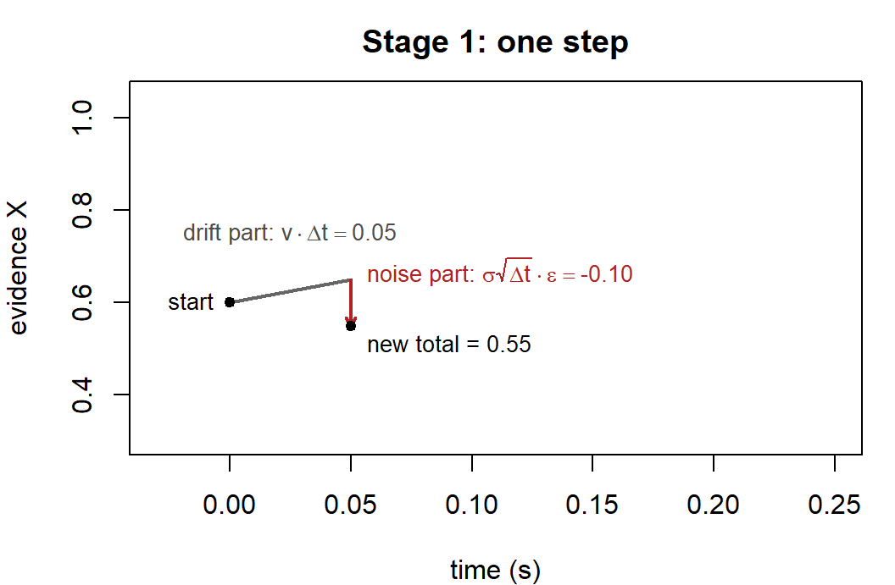
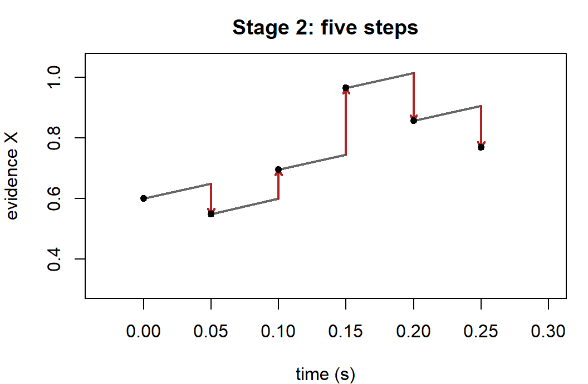
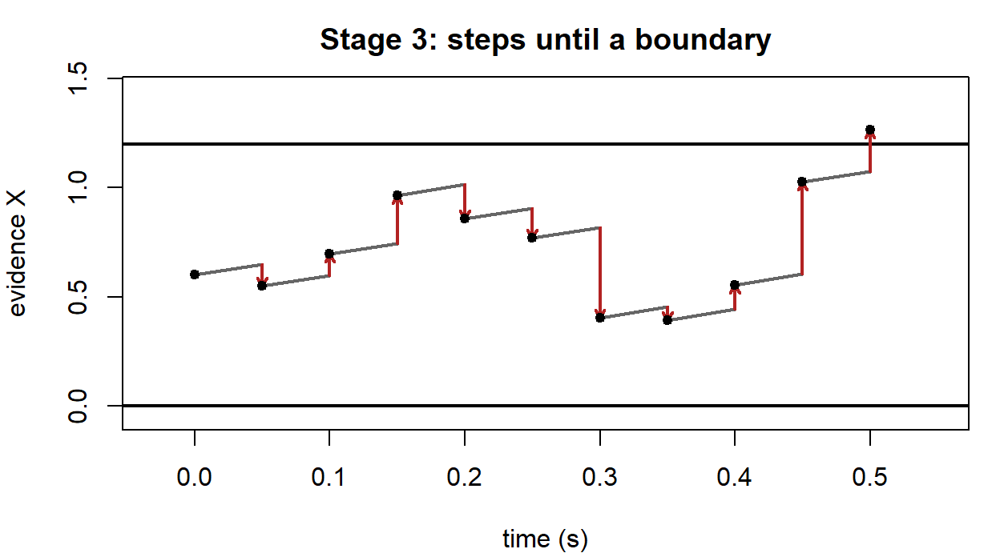
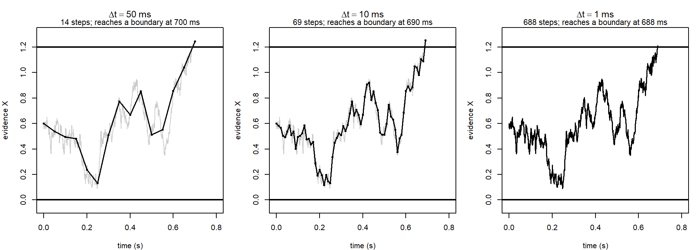
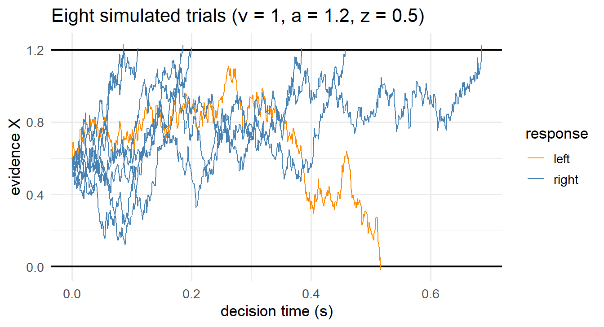

# One Step At A Time {#step-by-step}

This chapter builds a single trial of the DDM, one small step at a time. It is a way to
picture the model and to understand what each parameter does. It is not how the model
is fitted: from Chapter \@ref(paths-to-distributions) onwards, choices and RTs are
calculated from exact formulas, with no time steps and no simulated paths.

The trial is built in four stages: one step, a few steps, steps until a boundary is
reached, and then shorter and shorter steps. Each stage is shown three ways: the
equation, the R code that carries it out, and a picture of the result. The settings are
$v = 1$, $a = 1.2$, $z = 0.5$ and $\sigma = 1$, with long steps of $\Delta t = 0.05$ s
(50 ms) so that each step can be seen. A drift of 1 corresponds to fairly strong
rightward motion.

## Stage 1: One Step

**Equation.** In one step of length $\Delta t$, the evidence changes by

$$
\underbrace{X_{\text{new}} - X_{\text{old}}}_{\text{change in one step}}
= \underbrace{v\,\Delta t}_{\text{drift part}}
+ \underbrace{\sigma\sqrt{\Delta t}\;\varepsilon}_{\text{noise part}},
\qquad \varepsilon \sim N(0,1).
$$

- **$v$, the drift rate,** is the average amount of evidence gained per second. In one
  step of length $\Delta t$ the average gain is $v$ multiplied by $\Delta t$:
  $1 \times 0.05 = 0.05$ here. A negative $v$ (leftward motion) moves the total
  downwards on average.
- **$\varepsilon$** is a random number drawn from a standard normal distribution, the
  normal distribution with mean 0 and SD 1 (in R, `rnorm(1)`). It supplies the
  randomness, with the bell-curve shape, but has no particular size.
- **$\sigma\sqrt{\Delta t}$** sets the size. If every draw from a distribution is
  multiplied by the same constant, the results follow a distribution whose SD is that
  constant times the original SD, and a mean of 0 stays 0. So the noise part,
  $\sigma\sqrt{\Delta t}\,\varepsilon$, is a draw from a normal distribution with mean 0
  and SD $\sigma\sqrt{\Delta t}$: $\sqrt{0.05} \approx 0.22$ here. On average it pushes
  neither up nor down, and a typical push is about 0.22 in size.
- **$\sigma$** is the SD of the noise added up over one second, the unit of time used for
  RTs. $\sqrt{\Delta t}$ converts this into the SD for one step (Section
  \@ref(why-sqrt) explains why it is the square root).

**Code.** Each term of the equation is one line:


``` r
v <- 1; a <- 1.2; z <- 0.5; sigma <- 1
dt <- 0.05
set.seed(58)

x_old      <- z * a                              # start: 0.6
drift_part <- v * dt                             # v * dt
noise_part <- sigma * sqrt(dt) * rnorm(1)        # sigma * sqrt(dt) * epsilon
x_new      <- x_old + drift_part + noise_part
c(x_old = x_old, drift_part = drift_part, noise_part = noise_part, x_new = x_new)
```

```
##      x_old drift_part noise_part      x_new 
##      0.600      0.050     -0.101      0.549
```

**Picture.**



The grey line is the drift part: where the total would go with no noise. The red arrow
is the noise part. This draw of $\varepsilon$ was negative, so the noise pushed down by
more than the drift pushed up, and the step ends slightly lower than it started. The dot
at the end is the new total.

## Stage 2: A Few Steps

**Equation.** The end of one step is the start of the next. Numbering the steps
$k = 0, 1, 2, \dots$:

$$
X_{k+1} = X_k + v\,\Delta t + \sigma\sqrt{\Delta t}\;\varepsilon_k,
\qquad X_0 = z\,a,
$$

with a new, independent $\varepsilon_k$ on every step.

**Code.** The same line inside a loop. Setting the same seed makes the first step
identical to stage 1.


``` r
set.seed(58)
n_steps <- 5
x <- numeric(n_steps + 1)
x[1] <- z * a
for (k in 1:n_steps) {
  x[k + 1] <- x[k] + v * dt + sigma * sqrt(dt) * rnorm(1)
}
round(x, 3)
```

```
## [1] 0.600 0.549 0.696 0.965 0.857 0.769
```

**Picture.**



The grey drift parts are the same on every step. The red noise parts differ in size and
direction from step to step, so the total moves irregularly.

## Stage 3: Steps Until A Boundary

**Equation.** Keep stepping until the total reaches a boundary. The trial ends at the
first step $K$ where

$$
X_K \ge a \quad (\text{response "right"}) \qquad \text{or} \qquad X_K \le 0 \quad (\text{response "left"}),
$$

and the decision time is $K \Delta t$.

**Code.** The loop now runs until a boundary is reached, using `while`. This function is
the simulator used in the rest of the book.


``` r
# Simulate one trial step by step (dt in seconds).
simulate_ddm_trial <- function(v, a, z, t0, dt = 0.001, sigma = 1, keep_path = FALSE) {
  x <- z * a
  t <- 0
  path <- x
  while (x > 0 && x < a) {
    x <- x + v * dt + sigma * sqrt(dt) * rnorm(1)
    t <- t + dt
    if (keep_path) path <- c(path, x)
  }
  list(upper = x >= a, rt = t0 + t, path = path)
}

set.seed(58)
trial <- simulate_ddm_trial(v, a, z, t0 = 0, dt = dt, keep_path = TRUE)
c(upper = trial$upper, decision_time = trial$rt, steps = length(trial$path) - 1)
```

```
##         upper decision_time         steps 
##           1.0           0.5          10.0
```

**Picture.**



The first five steps are those from stage 2. Over the following steps the noise pushes
partly cancel out and the drift adds up, and the total passes the upper boundary: the
response is "right", and the decision time is the time of the last step. The last step
goes past the boundary because the total is checked only at the end of each step.

## Stage 4: The Same Trial With Shorter Steps

Real decisions do not happen in 50 ms jumps. The figure below shows what happens as the
steps get shorter, using one trial drawn at three step sizes. This is a new trial, not
the one from stage 3.

To draw the same trial at several step sizes, the random numbers are generated once, at
1 ms resolution. The noise in one 50 ms step is then the sum of the 50 one-millisecond
noise values inside it. That sum is itself a draw from a normal distribution with mean 0
and SD $\sigma\sqrt{0.05}$, which is what the step equation requires.


``` r
dt_fine <- 0.001
set.seed(131)
W_fine <- c(0, cumsum(sigma * sqrt(dt_fine) * rnorm(3000)))   # noise added up, at 1 ms resolution

# The same trial with steps of length dt_step: the evidence at the end of each step
step_path <- function(dt_step) {
  m   <- round(dt_step / dt_fine)
  idx <- seq(1, length(W_fine), by = m)
  t   <- (idx - 1) * dt_fine
  X   <- z * a + v * t + W_fine[idx]           # start + drift so far + noise so far
  hit <- which(X >= a | X <= 0)[1]             # first step at or past a boundary
  list(t = t[1:hit], X = X[1:hit], dt = dt_step)
}
p50 <- step_path(0.05)
p10 <- step_path(0.01)
p1  <- step_path(0.001)
```



The grey line in each panel is the 1 ms version. As the steps get shorter, each step's
drift part shrinks in proportion to $\Delta t$ and each step's noise part in proportion
to $\sqrt{\Delta t}$. The path picks up finer detail but keeps the same overall course,
and the time at which it reaches the boundary settles down
(700, 690 and
688 ms here). With long steps the boundary crossing is detected
late, because the total is only checked at the end of each step.

## Why The Noise Is Scaled By The Square Root {#why-sqrt}

The noise is scaled by $\sqrt{\Delta t}$ rather than $\Delta t$ so that the model does
not depend on the step size. The noise parts of different steps are independent, and the
variances of independent random quantities add when the quantities are added. One
second contains $1/\Delta t$ steps, each with variance $\sigma^2 \Delta t$, so the noise
added up over one second has variance $(1/\Delta t) \times \sigma^2 \Delta t = \sigma^2$
and SD $\sigma$, whatever $\Delta t$ is. If the noise were scaled by $\Delta t$, its
variance per second would shrink to 0 as the steps got shorter, and the noise would
disappear.

With 50 ms steps a typical noise push (0.22) is about 4 times the drift part (0.05). With
1 ms steps it is about 30 times larger (0.03 against 0.001). On any single step the noise
dominates. Over many steps the noise pushes largely cancel and the drift adds up, which
is why the total moves steadily on average.

## The Continuous-Time Equation

The DDM treats the steps as infinitely short. In that limit the step equation is written

$$
dX(t) = v\,dt + \sigma\,dW(t),
$$

which reads: a tiny change in evidence equals a tiny bit of drift plus a tiny bit of
noise. It is shorthand for the step equation, not a new model. The $d$ means "a very
small change in":

- $dt$ is a very short interval of time (the limit of $\Delta t$);
- $dX(t)$ is the change in the evidence total during that interval (the limit of
  $X_{k+1} - X_k$);
- $v\,dt$ is the drift part for that interval;
- $dW(t)$ is the random change in that interval. $W$ is called a Wiener process
  (Brownian motion), and its change over an interval $dt$ is normally distributed with
  mean 0 and variance $dt$, so it plays the role of $\sqrt{\Delta t}\,\varepsilon$ in the
  step equation. This is where the name "Wiener first-passage time" in Chapter
  \@ref(paths-to-distributions) comes from.

Appendix \@ref(calculus) explains the calculus behind this notation, for anyone who
wants it. You do not need it for the rest of the book.

$\sigma$ has to be fixed because only the size of the drift and boundary relative to the
noise affects behaviour. Doubling $v$, $a$ and $\sigma$ together leaves the predicted
choices and RTs unchanged. This book uses $\sigma = 1$, as does the `rtdists` package.
Some packages and papers use $\sigma = 0.1$, which makes their values of $a$ and $v$ ten
times smaller, so check which convention a paper used before comparing numbers.

## Many Trials

Running the simulator again gives a different trial each time, because the noise is
different. Eight trials with 1 ms steps:


``` r
eight_trials <- map_dfr(1:8, function(i) {
  tr <- simulate_ddm_trial(v = 1, a = 1.2, z = 0.5, t0 = 0, keep_path = TRUE)
  tibble(trial = i,
         time = seq(0, by = 0.001, length.out = length(tr$path)),
         evidence = tr$path,
         response = if (tr$upper) "right" else "left")
})

ggplot(eight_trials, aes(x = time, y = evidence, group = trial, colour = response)) +
  geom_hline(yintercept = c(0, 1.2), linewidth = 0.8) +
  geom_line(linewidth = 0.4) +
  scale_colour_manual(values = c(right = "steelblue", left = "darkorange")) +
  labs(x = "decision time (s)", y = "evidence X", colour = "response",
       title = "Eight simulated trials (v = 1, a = 1.2, z = 0.5)")
```



Because $v > 0$, most trials end at the upper boundary, but a few reach the lower one by
chance: these are errors. Trials that take a long time to reach a boundary make up the
long right tail of the RT distribution. Chapter \@ref(paths-to-distributions) continues
from here, from a few trials to thousands.
