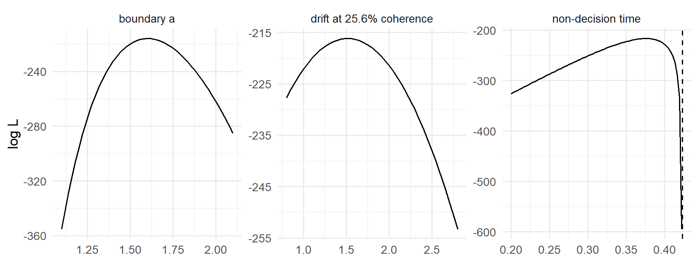

# Fitting The Model {#fitting}

This chapter fits the DDM to one participant's data by **maximum likelihood**: finding
the parameter values under which the observed responses and RTs are most probable.

## The Data For One Participant

We start with participant P01's accuracy blocks: 300 trials, 100 at each coherence
level, half with leftward and half with rightward motion. The upper boundary is the
response "right".


``` r
rdm <- read_csv("data/rdm.csv", show_col_types = FALSE)

p01 <- rdm |>
  filter(participant == "P01", instruction == "accuracy") |>
  mutate(upper = response == "right")

p01 |> count(coherence, direction)
```

<div class="kable-table">

| coherence|direction |  n|
|---------:|:---------|--:|
|     0.064|left      | 50|
|     0.064|right     | 50|
|     0.128|left      | 50|
|     0.128|right     | 50|
|     0.256|left      | 50|
|     0.256|right     | 50|

</div>

## The Model For These Data

The drift depends on how strong the motion is and which way it goes. The model has one
drift **strength** for each coherence level, and the direction sets its sign:

$$
v_i = \begin{cases} +v_c & \text{if the motion on trial } i \text{ is rightward} \\ -v_c & \text{if it is leftward} \end{cases}
$$

where $c$ is the trial's coherence. Boundary separation $a$, starting point $z$ and
non-decision time $T_{er}$ are the same on every trial. That gives six parameters:
$a$, $z$, $T_{er}$, $v_{6.4}$, $v_{12.8}$ and $v_{25.6}$.

## The Likelihood Of The Data

Trials are assumed to be independent given the parameters, so the likelihood of the data
is the product of the trial densities from Chapter \@ref(paths-to-distributions), and
the log-likelihood is the sum of their logs:

$$
\log L(\boldsymbol\theta) = \sum_{i=1}^{N} \log f_{r_i}\!\left(\text{RT}_i - T_{er} \mid v_i, a, z\right)
$$

$r_i$ is trial $i$'s response (which boundary) and $v_i$ its drift.

**Code.** The drift for each trial is built as a vector, and `ddm_density()` does the
rest:


``` r
make_drift <- function(v_by_coherence, coherence, direction) {
  strength <- v_by_coherence[match(coherence, c(0.064, 0.128, 0.256))]
  ifelse(direction == "right", strength, -strength)
}

loglik_rdm <- function(a, z, t0, v_by_coherence, data) {
  v <- make_drift(v_by_coherence, data$coherence, data$direction)
  sum(log(ddm_density(data$rt, data$upper, v, a, z, t0)))
}

loglik_rdm(a = 1.5, z = 0.5, t0 = 0.3, v_by_coherence = c(0.5, 1, 1.5), data = p01)
```

```
## [1] -261
```

## Picturing The Likelihood

Holding five parameters fixed and varying the sixth shows the log-likelihood rising to a
peak. Fitting finds the peak in all six dimensions at once.


``` r
# Values to hold the other parameters at (close to the peak)
a_fix <- 1.55; z_fix <- 0.53; t0_fix <- 0.37; v_fix <- c(0.45, 0.87, 1.7)

profiles <- bind_rows(
  tibble(parameter = "drift at 25.6% coherence", value = seq(0.8, 2.8, 0.05)) |>
    mutate(logL = map_dbl(value, \(x) loglik_rdm(a_fix, z_fix, t0_fix, c(v_fix[1:2], x), p01))),
  tibble(parameter = "boundary a", value = seq(1.1, 2.1, 0.02)) |>
    mutate(logL = map_dbl(value, \(x) loglik_rdm(x, z_fix, t0_fix, v_fix, p01))),
  tibble(parameter = "non-decision time", value = seq(0.2, min(p01$rt) - 0.001, length.out = 80)) |>
    mutate(logL = map_dbl(value, \(x) loglik_rdm(a_fix, z_fix, x, v_fix, p01)))
)

ggplot(profiles, aes(x = value, y = logL)) +
  geom_line() +
  geom_vline(data = tibble(parameter = "non-decision time", value = min(p01$rt)),
             aes(xintercept = value), linetype = "dashed") +
  facet_wrap(~ parameter, scales = "free") +
  labs(x = NULL, y = "log L")
```



In the right-hand panel, as $T_{er}$ approaches the fastest RT (dashed line), that
trial's decision time approaches zero, its density falls to zero, and $\log L$ falls
without limit. A single very fast response, such as an anticipation, therefore sets an
upper limit on $T_{er}$ for the whole dataset. Fast outliers need to be removed before
fitting or included in the model (Chapter \@ref(deadlines-lapses)).

## Transforming The Parameters

The parameters have limits: $a > 0$, $0 < z < 1$ and $0 < T_{er} < \min(\text{RT})$. The
optimiser works on transformed values that have no limits, and the likelihood function
converts them back:

| Parameter | Limits | Value the optimiser works with |
|---|---|---|
| $a$ | above 0 | $\log a$ |
| $z$ | between 0 and 1 | $\text{logit}\, z$ |
| $T_{er}$ | between 0 and the fastest RT | $\text{logit}(T_{er} / \min \text{RT})$ |
| $v_c$ | none | $v_c$ |

In MATLAB the same limits could be set as bounds in `fmincon`. Transforming them allows
an unconstrained optimiser to be used instead.


``` r
to_natural <- function(u, min_rt) {
  c(a = exp(u[1]), z = plogis(u[2]), t0 = min_rt * plogis(u[3]),
    v_064 = u[4], v_128 = u[5], v_256 = u[6])
}

neg_loglik_u <- function(u, data) {
  p <- to_natural(u, min(data$rt))
  -loglik_rdm(p[["a"]], p[["z"]], p[["t0"]], p[4:6], data)
}
```

## Fitting From Several Starting Points

$a$, $v$ and $T_{er}$ partly trade off against each other, so the log-likelihood surface
has long, flat ridges and a single starting point can stop short of the peak. The
function below starts from several points and keeps the best result.


``` r
fit_rdm <- function(data, n_starts = 5) {
  min_rt <- min(data$rt)
  starts <- cbind(c(log(1.5), 0, 0, 0.5, 1, 1.5),
                  replicate(n_starts - 1, c(log(runif(1, 0.8, 2.5)), rnorm(1, 0, 0.3),
                                            rnorm(1, 0, 1), runif(3, 0, 2))))
  fits <- apply(starts, 2, function(s)
    optim(s, neg_loglik_u, data = data, method = "BFGS", control = list(maxit = 1000)))
  best <- fits[[which.min(sapply(fits, `[[`, "value"))]]
  list(u = best$par, par = to_natural(best$par, min_rt), logLik = -best$value,
       converged = best$convergence == 0)
}

set.seed(1)
fit_p01 <- fit_rdm(p01)
round(fit_p01$par, 3)
```

```
##     a     z    t0 v_064 v_128 v_256 
## 1.581 0.528 0.371 0.394 0.589 1.548
```

## Comparing With The True Values

Because the data were simulated, we know the values they were generated with. The drift
strengths were $k \times$ coherence, with a different $k$ for each participant.


``` r
truth <- read_csv("data/rdm_truth.csv", show_col_types = FALSE)

t01 <- truth |> filter(participant == "P01")
true_p01 <- c(a = t01$a_accuracy, z = t01$z, t0 = t01$t0,
              v_064 = t01$k * 0.064, v_128 = t01$k * 0.128, v_256 = t01$k * 0.256)

tibble(parameter = names(true_p01), true = true_p01, estimate = fit_p01$par)
```

<div class="kable-table">

|parameter |  true| estimate|
|:---------|-----:|--------:|
|a         | 1.554|    1.581|
|z         | 0.532|    0.528|
|t0        | 0.372|    0.371|
|v_064     | 0.435|    0.394|
|v_128     | 0.870|    0.589|
|v_256     | 1.739|    1.548|

</div>

The estimates are close to the true values, but not identical: 300 trials carry only so
much information. The next section puts a number on that.

## Standard Errors

The curvature of the log-likelihood at its peak shows how precisely the data determine
each parameter. A sharp peak means a precise estimate. The inverse of the Hessian of
$-\log L$ (its matrix of second derivatives) approximates the covariance matrix of the
estimates:

$$
\widehat{\text{Cov}}(\hat{\mathbf u}) \approx H^{-1}, \qquad
H_{jk} = \frac{\partial^2 \left(-\log L\right)}{\partial u_j\, \partial u_k}\bigg|_{\hat{\mathbf u}}
$$

The Hessian is calculated for the transformed parameters. The delta method converts the
standard errors back: each is multiplied by the derivative of its back-transformation.


``` r
H <- optimHess(fit_p01$u, neg_loglik_u, data = p01)
se_u <- sqrt(diag(solve(H)))
p <- fit_p01$par
min_rt <- min(p01$rt)
deriv <- c(p[["a"]], p[["z"]] * (1 - p[["z"]]), p[["t0"]] * (1 - p[["t0"]] / min_rt), 1, 1, 1)
tibble(parameter = names(p), true = true_p01, estimate = p, se = deriv * se_u)
```

<div class="kable-table">

|parameter |  true| estimate|    se|
|:---------|-----:|--------:|-----:|
|a         | 1.554|    1.581| 0.048|
|z         | 0.532|    0.528| 0.016|
|t0        | 0.372|    0.371| 0.009|
|v_064     | 0.435|    0.394| 0.134|
|v_128     | 0.870|    0.589| 0.131|
|v_256     | 1.739|    1.548| 0.154|

</div>


Here 5 of the 6 true values lie within two standard errors of their
estimates. That is about what to expect: an interval of two standard errors either side
of an estimate misses the true value about one time in twenty, so with six parameters
an occasional miss, by a little more than two standard errors, is not unusual.

The correlations between the estimates show which parameters trade off:


``` r
C <- cov2cor(solve(H))
dimnames(C) <- list(names(p), names(p))
round(C, 2)   # correlations of the transformed parameters
```

```
##           a     z    t0 v_064 v_128 v_256
## a      1.00  0.08 -0.61  0.06  0.10  0.19
## z      0.08  1.00 -0.02  0.01  0.01  0.02
## t0    -0.61 -0.02  1.00 -0.01 -0.02  0.01
## v_064  0.06  0.01 -0.01  1.00  0.01  0.02
## v_128  0.10  0.01 -0.02  0.01  1.00  0.03
## v_256  0.19  0.02  0.01  0.02  0.03  1.00
```
